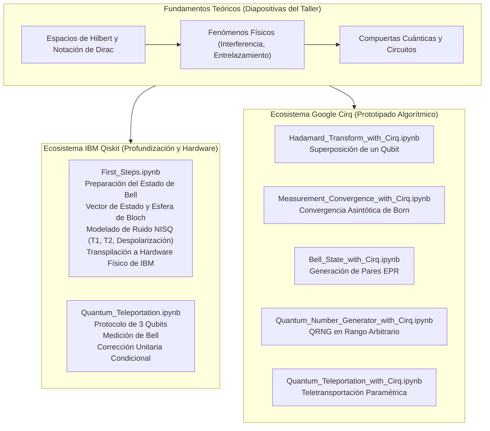

<div align="center">

# Computación Cuántica
### *De los Fundamentos Matemáticos a la Simulación NISQ y Hardware Físico*

[](https://www.python.org/)
[](https://qiskit.org/)
[](https://quantumai.google/cirq)
[](https://jupyter.org/)
[](https://www.udlap.mx/)
[](LICENSE)

**Idioma / Language:** [Español (Actual)](README.es.md) &nbsp;|&nbsp; [English](README.md)

---

</div>

## Visión General

Este repositorio contiene una colección completa, pedagógica y rigurosa de **algoritmos, simulaciones y diapositivas de computación cuántica** desarrollados como notas de estudio y material práctico para el taller **Verano STEM UDLAP 2026** (*"Una Brevísima Introducción a la Computación Cuántica"*).

El repositorio conecta la **mecánica cuántica teórica** (notación de Dirac, espacios de Hilbert, evolución unitaria) con la **ingeniería de software cuántico moderna**, implementando circuitos y protocolos en dos de los ecosistemas líderes de la industria:
1. **IBM Qiskit**: Simulación exacta de vectores de estado, tomografía de matrices de densidad, modelado realista de ruido NISQ y transpilación para hardware cuántico real.
2. **Google Cirq**: Prototipado algorítmico, generador cuántico de números aleatorios (QRNG), convergencia estadística de la regla de Born y teletransportación cuántica paramétrica.

---

## Arquitectura del Repositorio

```text
Quantum-Computing/
├── A very brief introduction to quantum computing (workshop slides).pdf
├── First_Steps.ipynb
├── Quantum_Teleportation.ipynb
├── Bell_State_with_Cirq.ipynb
├── Hadamard_Transform_with_Cirq.ipynb
├── Measurement_Convergence_with_Cirq.ipynb
├── Quantum_Number_Generator_with_Cirq.ipynb
├── Quantum_Teleportation_with_Cirq.ipynb
├── requirements.txt
├── .gitignore
├── README.md          <-- (Documentación en inglés)
└── README.es.md       <-- (Documentación en español)
```

### Matriz de Módulos y Notebooks

| Archivo | Framework | Nivel | Conceptos Clave |
| :--- | :---: | :---: | :--- |
| [`First_Steps.ipynb`](First_Steps.ipynb) | **Qiskit** | Avanzado | Espacios de Hilbert, estado de Bell $|\Phi^+\rangle$, multivector de Bloch, tomografía de estado, ruido NISQ ($T_1, T_2$, despolarización), transpilación y ejecución en hardware real de IBM |
| [`Quantum_Teleportation.ipynb`](Quantum_Teleportation.ipynb) | **Qiskit** | Interm./Avanz. | Teorema de no-clonación, canal EPR, medición en base de Bell, correcciones unitarias de Pauli ($X$, $Z$), simulación QASM |
| [`Bell_State_with_Cirq.ipynb`](Bell_State_with_Cirq.ipynb) | **Cirq** | Introductorio | Generación de entrelazamiento, `LineQubit`, compuertas Hadamard y CNOT, análisis de histogramas |
| [`Hadamard_Transform_with_Cirq.ipynb`](Hadamard_Transform_with_Cirq.ipynb) | **Cirq** | Introductorio | Superposición en un solo qubit, `GridQubit`, medición proyectiva, análisis frecuencial 50/50 |
| [`Measurement_Convergence_with_Cirq.ipynb`](Measurement_Convergence_with_Cirq.ipynb) | **Cirq** | Intermedio | Ley de los grandes números en física cuántica, convergencia asintótica de $P(\|0\rangle) \to 0.5$ con $N \in [10, 1000]$ disparos |
| [`Quantum_Number_Generator_with_Cirq.ipynb`](Quantum_Number_Generator_with_Cirq.ipynb) | **Cirq** | Intermedio | Generador Cuántico de Números Aleatorios (QRNG), asignación dinámica de qubits $k = \lceil\log_2(M)\rceil$, muestreo por rechazo |
| [`Quantum_Teleportation_with_Cirq.ipynb`](Quantum_Teleportation_with_Cirq.ipynb) | **Cirq** | Intermedio | Teletransportación de estados arbitrarios ($H, X, Y, I$), operaciones clásicamente controladas `CNOT` y `CZ` |
| `slides.pdf` | **Teoría** | General | Presentación completa de 57 diapositivas del taller Verano STEM UDLAP 2026 |

---

## Análisis Detallado de los Módulos



---

### Eje 1: IBM Qiskit (Rigor Matemático y Hardware Real)

#### 1. [`First_Steps.ipynb`](First_Steps.ipynb) — *El Camino Completo: De la Teoría al Hardware Físico*
Este es el notebook central del repositorio, estructurado en tres niveles de profundidad:

* **Derivación Analítica Formal**:
  El espacio de estados compuesto de dos qubits reside en el producto tensorial $\mathcal{H} = \mathcal{H}_1 \otimes \mathcal{H}_2 \cong \mathbb{C}^4$, con base computacional:
  $$\{|00\rangle, |01\rangle, |10\rangle, |11\rangle\}$$
  Aplicando una compuerta Hadamard al qubit 0 y una compuerta CNOT controlada en el qubit 0 hacia el qubit 1, generamos el estado de Bell entrelazado $|\Phi^+\rangle$:
  $$|00\rangle \xrightarrow{H \otimes I} \frac{1}{\sqrt{2}}(|0\rangle + |1\rangle)|0\rangle = \frac{1}{\sqrt{2}}(|00\rangle + |10\rangle) \xrightarrow{CNOT_{0 \to 1}} |\Phi^+\rangle = \frac{1}{\sqrt{2}}(|00\rangle + |11\rangle)$$
* **Evolución del Vector de Estado Ideal**:
  Utiliza el `statevector_simulator` de Qiskit Aer para obtener las amplitudes complejas de probabilidad exactas y renderizar matrices en LaTeX.
* **Análisis en la Esfera de Bloch (Multivectores)**:
  Demuestra que al calcular la traza parcial sobre cualquiera de los subsistemas, el estado reducido resultante es un estado máximamente mezclado:
  $$\rho_A = \text{Tr}_B(|\Phi^+\rangle\langle\Phi^+|) = \frac{1}{2}\mathbb{I}_2$$
  En la esfera de Bloch, este estado se sitúa exactamente en el centro (radio $r = 0$), demostrando visualmente que ningún qubit individual posee un estado cuántico definido por separado.
* **Postulado de Medición Proyectiva**:
  Muestreo estocástico con el simulador `qasm_simulator` (8,192 disparos), verificando que $P(00) = P(11) = 0.5$.
* **Modelado Realista de Ruido NISQ**:
  Construcción de un modelo de ruido basado en el procesador real `ibmq_lima`:
  - **Error despolarizante de 1 qubit**: $p_1 = 0.02$
  - **Error en compuerta CNOT**: $p_2 = 0.05$
  - **Relajación térmica**: Tiempo de relajación longitudinal $T_1 = 50\,\mu\text{s}$, tiempo de desfase transversal $T_2 = 70\,\mu\text{s}$, duración de compuerta $t_{\text{gate}} = 50\,\text{ns}$.
* **Tomografía Cuántica de Estados y Fidelidad**:
  Reconstrucción de la matriz de densidad ruidosa $\rho_{\text{ruidosa}}$ y evaluación de la fidelidad cuántica:
  $$F(\rho, \sigma) = \left( \text{Tr}\sqrt{\sqrt{\rho}\sigma\sqrt{\rho}} \right)^2$$
  Visualización 3D en estilo *city* de las componentes real e imaginaria.
* **Transpilación para Hardware de IBM**:
  Descomposición a compuertas nativas $\{cx, id, rz, sx, x\}$, adaptación al mapa de acoplamiento físico y flujo de ejecución en IBM Quantum mediante `qiskit-ibm-runtime`.
* **Análisis Comparativo Tripartito**:
  Histograma comparando directamente: **Simulación Ideal vs. Simulación Ruidosa vs. Hardware Cuántico Real**.

---

#### 2. [`Quantum_Teleportation.ipynb`](Quantum_Teleportation.ipynb) — *Protocolo de Teletransportación Cuántica*
Implementación detallada del célebre protocolo propuesto por Bennett et al. (1993):

1. **Configuración del Sistema**:
   Tres qubits:
   - $q_0$ (Qubit de datos de Alice): $|\psi\rangle = \alpha|0\rangle + \beta|1\rangle$ con $|\alpha|^2 + |\beta|^2 = 1$.
   - $q_1$ (Recurso de entrelazamiento de Alice): Parte del par EPR.
   - $q_2$ (Qubit receptor de Bob): La otra mitad del par EPR.
2. **Distribución del Par EPR**:
   Se prepara el estado $|\Phi^+\rangle_{12}$ entre los qubits $q_1$ y $q_2$.
3. **Operaciones de Entrelazamiento de Alice**:
   Alice aplica $CNOT_{0 \to 1}$ y $H_0$. El estado global del sistema de tres qubits se reorganiza como:
   $$|\Psi_3\rangle = \frac{1}{2} \Big[ |00\rangle_{01}(\alpha|0\rangle + \beta|1\rangle)_2 + |01\rangle_{01}(\alpha|1\rangle + \beta|0\rangle)_2 + |10\rangle_{01}(\alpha|0\rangle - \beta|1\rangle)_2 + |11\rangle_{01}(\alpha|1\rangle - \beta|0\rangle)_2 \Big]$$
4. **Medición y Transmisión Clásica**:
   Alice mide sus dos qubits obteniendo 2 bits clásicos ($c_0, c_1$). Bob aplica compuertas condicionales de Pauli:
   - Resultado `00`: $I$ (identidad)
   - Resultado `01`: $X$ (inversión de bit)
   - Resultado `10`: $Z$ (inversión de fase)
   - Resultado `11`: $Z \cdot X$ (inversión de bit y fase)
5. **Verificación de Reconstrucción**:
   Bob mide $q_2$ comprobando que el estado original $|\psi\rangle$ ha sido recuperado con fidelidad unitaria, cumpliendo el teorema de no-clonación.

---

### Eje 2: Google Cirq (Prototipado y Algoritmos)

#### 1. [`Bell_State_with_Cirq.ipynb`](Bell_State_with_Cirq.ipynb)
* Sintaxis idiomática de Cirq mediante `cirq.LineQubit.range(2)` y `cirq.Circuit`.
* Generación del par entrelazado mediante `cirq.H` y `cirq.CNOT`.
* Medición y obtención de histogramas mediante `cirq.Simulator`.

#### 2. [`Hadamard_Transform_with_Cirq.ipynb`](Hadamard_Transform_with_Cirq.ipynb)
* Superposición en un qubit 2D en grilla física: `cirq.GridQubit(0, 0)`.
* Transformación $|0\rangle \to |+\rangle = \frac{|0\rangle + |1\rangle}{\sqrt{2}}$.
* Evaluación probabilística con $N = 100$ repeticiones.

#### 3. [`Measurement_Convergence_with_Cirq.ipynb`](Measurement_Convergence_with_Cirq.ipynb)
* Demostración empírica de la **Ley de los Grandes Números** en la física cuántica.
* Variación continua del número de disparos $N \in [10, 1000]$.
* Gráfica de convergencia de $\hat{P}(0) = \frac{N_0}{N}$ hacia el valor teórico esperado $0.5$, ilustrando cómo la varianza estadística se reduce con tasa $\mathcal{O}(1/\sqrt{N})$.

#### 4. [`Quantum_Number_Generator_with_Cirq.ipynb`](Quantum_Number_Generator_with_Cirq.ipynb)
* **Generador Cuántico de Números Aleatorios Verdaderos (QRNG)** para cualquier intervalo $[low, high)$.
* **Flujo algorítmico**:
  1. Cálculo de qubits requeridos: $k = \lceil \log_2(high - low) \rceil$.
  2. Inicialización en superposición uniforme de $k$ qubits:
     $$|\psi\rangle = H^{\otimes k} |0\rangle^{\otimes k} = \frac{1}{\sqrt{2^k}} \sum_{x=0}^{2^k-1} |x\rangle$$
  3. Medición simultánea y conversión de cadenas de bits a enteros decimales.
  4. Muestreo por rechazo (*rejection sampling*) para garantizar uniformidad perfecta sin sesgos de frontera.

#### 5. [`Quantum_Teleportation_with_Cirq.ipynb`](Quantum_Teleportation_with_Cirq.ipynb)
* Implementación modular y parametrizable de teletransportación en Cirq.
* Preparación configurable del estado de entrada con compuertas $H, X, Y$ o $I$.
* Corrección cuántica posterior mediante `cirq.CNOT` y `cirq.CZ`.

---

### Eje 3: Diapositivas del Taller (workshop slides.pdf)

Presentación oficial de 57 diapositivas utilizada en el **Verano STEM UDLAP 2026**:

1. **Sección 1: ¿Por qué computación cuántica?**
   - Miniaturización del transistor y los límites de la Ley de Moore (efecto túnel, calor, costes de litografía).
   - Problemas imposibles en computación clásica: crecimiento exponencial ($2^n$) y factorial ($n!$) como el problema del viajante (TSP) o la simulación molecular de fármacos (cafeína, penicilina).
2. **Sección 2: Historia y origen**
   - Orígenes de la mecánica cuántica: Rutherford, Bohr, radiación de Planck, efecto fotoeléctrico de Einstein.
   - El reto de Richard Feynman (1981): simular la naturaleza a través de física cuántica en lugar de aproximaciones clásicas.
3. **Sección 3: Fundamentos matemáticos**
   - Álgebra lineal, números complejos y notación bra-ket de Dirac.
   - Espacios de Hilbert, producto interno y base computacional $\{|0\rangle, |1\rangle\}$.
   - Regla de Born y condición de normalización $\langle\psi|\psi\rangle = 1$.
   - Operadores unitarios ($U^\dagger U = \mathbb{I}$) y hermitianos ($H^\dagger = H$).
   - Producto tensorial ($A \otimes B$) y crecimiento dimensional exponencial $2^n$.
4. **Sección 4: Los fenómenos físicos**
   - Dualidad onda-partícula y relación de de Broglie ($p = h/\lambda$).
   - Experimento de la doble rendija: partículas vs. ondas vs. electrones y colapso por observación.
   - Principio de incertidumbre de Heisenberg ($\Delta x \Delta p_x \ge \hbar / 2$).
   - Entrelazamiento cuántico y estados no separables.
5. **Sección 5: Cómo computa lo cuántico**
   - Bit clásico vs. Qubit cuántico.
   - Representación geométrica en la Esfera de Bloch.
   - Compuertas lógicas cuánticas fundamentales (NOT / Pauli-$X$, Pauli-$Z$, Hadamard $H$, CNOT).
6. **Sección 6: Hardware y límites actuales**
   - Tecnologías de construcción: Circuitos superconductores (temperaturas de $\sim 15\,\text{mK}$) e iones atrapados.
   - Decoherencia cuántica y corrección de errores (qubits físicos vs. lógicos).
   - Aplicaciones de impacto: química y medicina, IA generativa y optimización, y criptografía post-cuántica.

---

## Guía de Instalación y Uso

### Requisitos Previos
* **Python 3.9, 3.10, 3.11 o 3.12**
* Gestor de paquetes `pip` y `git`
* (Opcional) Cuenta activa en [IBM Quantum Platform](https://quantum.ibm.com/) para ejecuciones en procesadores reales.

### Paso 1: Clonar el Repositorio
```bash
git clone https://github.com/AngelGab3/Quantum-Computing.git
cd Quantum-Computing
```

### Paso 2: Crear y Activar un Entorno Virtual
```bash
# En macOS / Linux:
python3 -m venv .venv
source .venv/bin/activate

# En Windows (PowerShell):
python -m venv .venv
.venv\Scripts\Activate.ps1
```

### Paso 3: Instalar Dependencias
```bash
pip install --upgrade pip
pip install -r requirements.txt
```

### Paso 4: Iniciar el Servidor de Jupyter
```bash
jupyter lab
# o bien
jupyter notebook
```

### Paso 5: (Opcional) Configurar Credenciales de IBM Quantum
Para ejecutar en hardware real en `First_Steps.ipynb`:
```python
from qiskit_ibm_runtime import QiskitRuntimeService

# Guarda tu token de API localmente (solo una vez)
QiskitRuntimeService.save_account(
    channel="ibm_quantum",
    token="TU_TOKEN_DE_IBM_QUANTUM",
    overwrite=True
)
```

---

## Equipo y Reconocimientos

Este repositorio fue creado como recurso educativo e investigación para el taller:

* **Gabriel Velázquez** — *Lic. en Física* (Autor principal e implementaciones en notebooks)
* **Martha Heredia** — *Ing. en Sistemas Computacionales* (Instructora del taller)
* **Rosh Guadiana** — *Ing. Biomédica* (Instructor del taller)

Impartido en el marco de **Verano STEM UDLAP 2026** (*Universidad de las Américas Puebla*).

---

## Licencia

Este proyecto es de código abierto bajo la [Licencia MIT](LICENSE).
