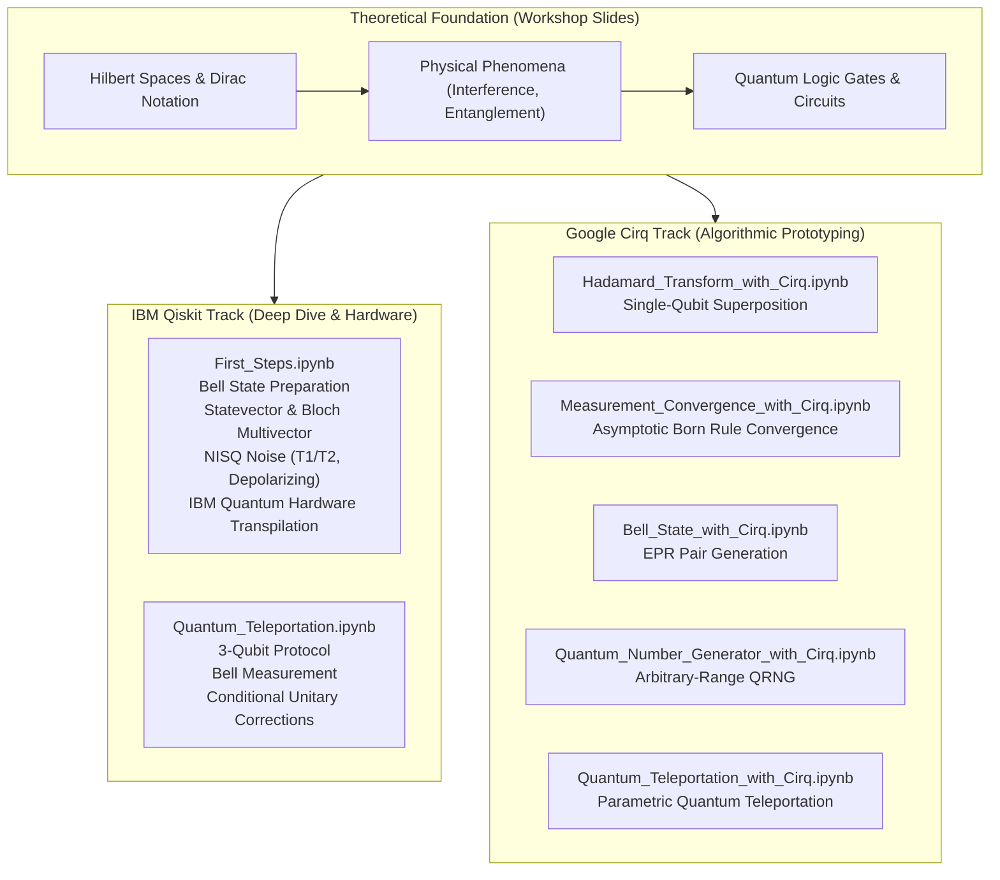

<div align="center">

# Quantum Computing
### *From Mathematical Foundations to NISQ Simulation & Physical Hardware*

[](https://www.python.org/)
[](https://qiskit.org/)
[](https://quantumai.google/cirq)
[](https://jupyter.org/)
[](https://www.udlap.mx/)
[](LICENSE)

**Language / Idioma:** [English (Current)](README.md) &nbsp;|&nbsp; [Español](README.es.md)

---

</div>

## Executive Overview

This repository contains a comprehensive, pedagogical, and rigorous collection of **quantum computing algorithms, simulations, and lecture materials** developed as study notes and workshop materials for the **Verano STEM UDLAP 2026** workshop (*"Una Brevísima Introducción a la Computación Cuántica"*).

The repository bridges the gap between **abstract quantum mechanics** (Dirac notation, Hilbert spaces, unitary evolution) and **practical quantum software engineering**, implementing quantum circuits using two of the industry's leading software development kits:
1. **IBM Qiskit**: Advanced statevector simulation, density matrix tomography, realistic NISQ hardware noise modeling, and real quantum device transpilation.
2. **Google Cirq**: Algorithmic prototyping, quantum random number generation (QRNG), convergence analysis of the Born rule, and parametric quantum teleportation.

---

## Repository Architecture

```text
Quantum-Computing/
├── A very brief introduction to quantum computing (workshop slides).pdf
├── First_Steps.ipynb
├── Quantum_Teleportation.ipynb
├── Bell_State_with_Cirq.ipynb
├── Hadamard_Transform_with_Cirq.ipynb
├── Measurement_Convergence_with_Cirq.ipynb
├── Quantum_Number_Generator_with_Cirq.ipynb
├── Quantum_Teleportation_with_Cirq.ipynb
├── requirements.txt
├── .gitignore
├── README.md          <-- (English documentation)
└── README.es.md       <-- (Documentación en Español)
```

### Module Classification Matrix

| File | Framework | Level | Core Topics |
| :--- | :---: | :---: | :--- |
| [`First_Steps.ipynb`](First_Steps.ipynb) | **Qiskit** | Advanced | Hilbert spaces, Bell state $|\Phi^+\rangle$, Bloch multivector, State Tomography, NISQ noise ($T_1, T_2$, depolarization), IBM Quantum hardware execution |
| [`Quantum_Teleportation.ipynb`](Quantum_Teleportation.ipynb) | **Qiskit** | Interm./Adv. | No-Cloning theorem, EPR channel, Bell basis measurement, conditional Pauli corrections ($X$, $Z$), ideal sampling |
| [`Bell_State_with_Cirq.ipynb`](Bell_State_with_Cirq.ipynb) | **Cirq** | Beginner | Entanglement preparation, `LineQubit`, Hadamard + CNOT gate sequence, measurement statistics |
| [`Hadamard_Transform_with_Cirq.ipynb`](Hadamard_Transform_with_Cirq.ipynb) | **Cirq** | Beginner | Single-qubit superposition, `GridQubit`, projective measurement, statistical frequency distributions |
| [`Measurement_Convergence_with_Cirq.ipynb`](Measurement_Convergence_with_Cirq.ipynb) | **Cirq** | Intermediate | Law of large numbers in quantum measurement, asymptotic convergence of $P(\|0\rangle) \to 0.5$ across $N \in [10, 1000]$ shots |
| [`Quantum_Number_Generator_with_Cirq.ipynb`](Quantum_Number_Generator_with_Cirq.ipynb) | **Cirq** | Intermediate | Quantum Random Number Generator (QRNG), dynamic qubit allocation $k = \lceil\log_2(M)\rceil$, rejection sampling |
| [`Quantum_Teleportation_with_Cirq.ipynb`](Quantum_Teleportation_with_Cirq.ipynb) | **Cirq** | Intermediate | Parametric state teleportation protocol ($H, X, Y, I$ input states), dynamic feedforward operations |
| `slides.pdf` | **Theory** | Overview | 57-slide workshop slide deck from Verano STEM UDLAP 2026 covering theory, physics experiments, and hardware limits |

---

## In-Depth Notebook Dossiers



---

### Track 1: IBM Qiskit (Analytical Rigor & Physical Hardware)

#### 1. [`First_Steps.ipynb`](First_Steps.ipynb) — *The Complete Journey from Theory to Real Hardware*
This is the flagship notebook of the repository, presenting a three-tier exploration of maximal entanglement:

* **Analytical Derivation**:
  The two-qubit composite state space is defined on the tensor product Hilbert space $\mathcal{H} = \mathcal{H}_1 \otimes \mathcal{H}_2 \cong \mathbb{C}^4$, with computational basis:
  $$\{|00\rangle, |01\rangle, |10\rangle, |11\rangle\}$$
  Applying a Hadamard gate on qubit 0 followed by a Controlled-NOT gate targeting qubit 1 creates the canonical Bell state $|\Phi^+\rangle$:
  $$|00\rangle \xrightarrow{H \otimes I} \frac{1}{\sqrt{2}}(|0\rangle + |1\rangle)|0\rangle = \frac{1}{\sqrt{2}}(|00\rangle + |10\rangle) \xrightarrow{CNOT_{0 \to 1}} |\Phi^+\rangle = \frac{1}{\sqrt{2}}(|00\rangle + |11\rangle)$$
* **Ideal Statevector Evolution**:
  Extracts exact complex probability amplitudes using Qiskit Aer's `statevector_simulator` and renders mathematical expressions via LaTeX.
* **Bloch Sphere Multivector Analysis**:
  Demonstrates that because $|\Phi^+\rangle$ is maximally entangled, the reduced density matrix of either individual subsystem is maximally mixed:
  $$\rho_A = \text{Tr}_B(|\Phi^+\rangle\langle\Phi^+|) = \frac{1}{2}|0\rangle\langle 0| + \frac{1}{2}|1\rangle\langle 1| = \frac{1}{2}\mathbb{I}_2$$
  On the Bloch sphere, this corresponds to the origin ($r = 0$), proving that neither qubit possesses an independent state.
* **Projective Measurement Postulate**:
  Simulates stochastic projective measurement with the `qasm_simulator` (8,192 shots) verifying Born's rule $P(00) = P(11) = 0.5$.
* **NISQ Noise Modeling**:
  Constructs a realistic device model based on IBM Quantum specifications (`ibmq_lima`):
  - **Single-qubit depolarizing error**: $p_1 = 0.02$
  - **Two-qubit gate error (CNOT)**: $p_2 = 0.05$
  - **Thermal relaxation**: Longitudinal relaxation time $T_1 = 50\,\mu\text{s}$, transverse dephasing time $T_2 = 70\,\mu\text{s}$, gate execution duration $t_{\text{gate}} = 50\,\text{ns}$.
* **Quantum State Tomography & State Fidelity**:
  Reconstructs the full noisy density matrix $\rho_{\text{noisy}}$ and evaluates state fidelity against the ideal pure state $|\Phi^+\rangle$:
  $$F(\rho, \sigma) = \left( \text{Tr}\sqrt{\sqrt{\rho}\sigma\sqrt{\rho}} \right)^2$$
  Visualizes both $\text{Re}(\rho)$ and $\text{Im}(\rho)$ using 3D city-style density plots.
* **Real IBM Quantum Hardware Transpilation**:
  Transpiles the circuit down to native hardware basis gates $\{cx, id, rz, sx, x\}$, taking coupling maps and qubit topologies into account, with full code for execution through `qiskit-ibm-runtime`.
* **Tripartite Comparative Benchmark**:
  Side-by-side histogram comparing Ideal Simulation vs. Noisy Simulation vs. Real Physical Quantum Hardware.

---

#### 2. [`Quantum_Teleportation.ipynb`](Quantum_Teleportation.ipynb) — *Quantum Teleportation Protocol*
Implements the landmark protocol (Bennett et al., 1993) overcoming the constraints of the **No-Cloning Theorem**:

1. **System Setup**:
   Three qubits:
   - $q_0$ (Alice's data qubit): $|\psi\rangle = \alpha|0\rangle + \beta|1\rangle$ (where $|\alpha|^2 + |\beta|^2 = 1$).
   - $q_1$ (Alice's entanglement resource): Half of an EPR pair.
   - $q_2$ (Bob's receiver qubit): The other half of the EPR pair.
2. **Entangled Channel Generation**:
   A Bell pair $|\Phi^+\rangle_{12}$ is generated between $q_1$ and $q_2$.
3. **Alice's Entangling & Basis Transformation**:
   Alice applies $CNOT_{0 \to 1}$ and $H_0$. The global state transforms into:
   $$|\Psi_3\rangle = \frac{1}{2} \Big[ |00\rangle_{01}(\alpha|0\rangle + \beta|1\rangle)_2 + |01\rangle_{01}(\alpha|1\rangle + \beta|0\rangle)_2 + |10\rangle_{01}(\alpha|0\rangle - \beta|1\rangle)_2 + |11\rangle_{01}(\alpha|1\rangle - \beta|0\rangle)_2 \Big]$$
4. **Measurement & Classical Feed-Forward**:
   Alice measures $q_0, q_1 \to c_0, c_1$. Based on the 2 classical bits sent to Bob, Bob applies conditional Pauli corrections:
   - Bit outcome `00`: $I$ (No action)
   - Bit outcome `01`: $X$ (Bit flip)
   - Bit outcome `10`: $Z$ (Phase flip)
   - Bit outcome `11`: $Z \cdot X$ (Phase and bit flip)
5. **Reconstruction Verification**:
   Bob measures $q_2$, proving that the state $|\psi\rangle$ has been teleported with unit fidelity while the original state was destroyed during Alice's measurement.

---

### Track 2: Google Cirq (Prototyping & Algorithms)

#### 1. [`Bell_State_with_Cirq.ipynb`](Bell_State_with_Cirq.ipynb)
* Demonstrates Cirq's programmatic syntax using `cirq.LineQubit.range(2)` and `cirq.Circuit`.
* Applies `cirq.H` and `cirq.CNOT`, followed by joint projective measurement.
* Simulates sampling distributions using `cirq.Simulator` and computes outcome histograms.

#### 2. [`Hadamard_Transform_with_Cirq.ipynb`](Hadamard_Transform_with_Cirq.ipynb)
* Implements a single-qubit Hadamard transformation on a 2D grid qubit `cirq.GridQubit(0, 0)`.
* Maps $|0\rangle \to |+\rangle = \frac{1}{\sqrt{2}}(|0\rangle + |1\rangle)$.
* Measures the qubit over $N = 100$ repetitions to visualize the equiprobable 50/50 distribution.

#### 3. [`Measurement_Convergence_with_Cirq.ipynb`](Measurement_Convergence_with_Cirq.ipynb)
* Empirical validation of the **Law of Large Numbers** in quantum mechanics.
* Iterates sample sizes $N \in [10, 1000]$ and computes the empirical estimator:
  $$\hat{P}(0) = \frac{N_0}{N}$$
* Plots the noisy convergence trace towards the theoretical expectation value $P(0) = 0.5$, demonstrating quantum statistical variance reducing as $\mathcal{O}(1/\sqrt{N})$.

#### 4. [`Quantum_Number_Generator_with_Cirq.ipynb`](Quantum_Number_Generator_with_Cirq.ipynb)
* Implements a **True Quantum Random Number Generator (QRNG)** for any arbitrary user interval $[low, high)$.
* **Algorithm**:
  1. Computes the minimum number of qubits required: $k = \lceil \log_2(high - low) \rceil$.
  2. Prepares a multi-qubit register in uniform superposition:
     $$|\psi\rangle = H^{\otimes k} |0\rangle^{\otimes k} = \frac{1}{\sqrt{2^k}} \sum_{x=0}^{2^k-1} |x\rangle$$
  3. Measures all qubits simultaneously to sample an integer from the uniform discrete distribution.
  4. Applies **rejection sampling** to ensure exact, unbiased generation within the desired interval $[low, high)$.

#### 5. [`Quantum_Teleportation_with_Cirq.ipynb`](Quantum_Teleportation_with_Cirq.ipynb)
* Parametric implementation of quantum teleportation in Cirq.
* Allows initializing Alice's state under various Pauli and Clifford operators ($H, X, Y, I$).
* Features feedforward gates using `cirq.CNOT` and `cirq.CZ` controlled by measurement registers.

---

### Track 3: Workshop Slide Deck (workshop slides.pdf)

The repository includes the complete 57-slide presentation **"Una Brevísima Introducción a la Computación Cuántica"** delivered at **Verano STEM UDLAP 2026**:

1. **Section 1: Why Quantum Computing?**
   - Transistor miniaturization and the physical limits of Moore's Law (quantum tunneling, thermal dissipation, fabrication economics).
   - Computational complexity: $P$ vs $NP$, exponential $2^n$ and factorial $n!$ scaling problems (Traveling Salesperson Problem, molecular simulation).
2. **Section 2: History & Origin**
   - Quantum mechanics pioneers (Rutherford, Bohr, Planck's blackbody radiation, Einstein's photoelectric effect).
   - Richard Feynman's 1981 challenge: *"Nature isn't classical, dammit, and if you want to make a simulation of nature, you'd better make it quantum mechanical."*
3. **Section 3: Mathematical Foundations**
   - Dirac notation ($|\psi\rangle$, $\langle\psi|$, $\langle\phi|\psi\rangle$).
   - Hilbert space axioms, inner products, and computational basis vectors $|0\rangle = \begin{pmatrix}1\\0\end{pmatrix}$, $|1\rangle = \begin{pmatrix}0\\1\end{pmatrix}$.
   - Born rule and state normalization: $\langle\psi|\psi\rangle = |\alpha|^2 + |\beta|^2 = 1$.
   - Unitary operators ($U^\dagger U = \mathbb{I}$) preserving norm and reversibility; Hermitian operators ($H^\dagger = H$) representing physical observables.
   - Tensor products ($A \otimes B$) and state space expansion $\text{dim}(\mathcal{H}^{\otimes n}) = 2^n$.
4. **Section 4: Fundamental Physical Phenomena**
   - Wave-particle duality (de Broglie hypothesis $\lambda = h/p$).
   - Double-slit experiment analysis (classical particles vs waves vs electrons vs detector observation collapse).
   - Superposition, quantum interference (constructive & destructive amplitude combinations).
   - Heisenberg Uncertainty Principle ($\Delta x \Delta p_x \ge \frac{\hbar}{2}$).
   - Quantum entanglement: non-separable composite states $|\Psi\rangle \ne |\phi_A\rangle \otimes |\phi_B\rangle$.
5. **Section 5: How Quantum Computes**
   - Classical Bit vs Quantum Qubit.
   - Bloch Sphere geometric representation: $|\psi\rangle = \cos(\frac{\theta}{2})|0\rangle + e^{i\phi}\sin(\frac{\theta}{2})|1\rangle$.
   - Quantum logic gate matrix representations (Pauli-$X$, Pauli-$Z$, Hadamard $H$, CNOT).
6. **Section 6: Hardware Realities & The Road Ahead**
   - Physical qubit platforms: Superconducting circuits (dilution refrigerators at $\sim 15\,\text{mK}$) and Trapped Ions.
   - Quantum decoherence and the quantum error correction threshold (physical vs fault-tolerant logical qubits).
   - Industrial applications: molecular design, pharmaceutical synthesis, AI model optimization, post-quantum cryptography (PQC), and logistics.

---

## Getting Started & Installation

### Prerequisites
* **Python 3.9, 3.10, 3.11, or 3.12**
* `pip` and `git`
* (Optional) An active [IBM Quantum Platform](https://quantum.ibm.com/) account for physical hardware execution.

### Step 1: Clone the Repository
```bash
git clone https://github.com/AngelGab3/Quantum-Computing.git
cd Quantum-Computing
```

### Step 2: Create and Activate a Virtual Environment
```bash
# macOS / Linux
python3 -m venv .venv
source .venv/bin/activate

# Windows (PowerShell)
python -m venv .venv
.venv\Scripts\Activate.ps1
```

### Step 3: Install Dependencies
```bash
pip install --upgrade pip
pip install -r requirements.txt
```

### Step 4: Launch Jupyter Lab or Notebook
```bash
jupyter lab
# or
jupyter notebook
```

### Step 5: (Optional) Configure IBM Quantum Credentials
If you wish to run circuits on IBM Quantum hardware in `First_Steps.ipynb`:
```python
from qiskit_ibm_runtime import QiskitRuntimeService

# Save your API token to disk (only needed once)
QiskitRuntimeService.save_account(
    channel="ibm_quantum",
    token="YOUR_IBM_QUANTUM_API_TOKEN",
    overwrite=True
)
```

---

## Dependencies & Tech Stack

All versions are specified in [`requirements.txt`](requirements.txt):

* **`qiskit` & `qiskit-aer`**: IBM's core SDK for quantum circuits, pulse control, statevector analysis, and high-performance C++ simulator backends.
* **`qiskit-ibm-runtime`**: Client interface for accessing real IBM Quantum superconducting processors and cloud primitives (`Sampler`, `Estimator`).
* **`cirq`**: Google Quantum AI's library for writing, manipulating, and optimizing quantum circuits.
* **`numpy` & `scipy`**: Linear algebra, matrix exponentiation, and probability distributions.
* **`matplotlib` & `seaborn`**: High-quality data visualization and statistical distribution plots.
* **`pylatexenc`**: Circuit diagram LaTeX typography rendering in Jupyter.

---

## Authors & Acknowledgments

This repository was created as an educational resource and research study repository:

* **Gabriel Velázquez** — *Lic. en Física* (Lead author & notebook implementations)
* **Martha Heredia** — *Ing. en Sistemas Computacionales* (Workshop instructor)
* **Rosh Guadiana** — *Ing. Biomédica* (Workshop instructor)

Presented and developed in collaboration with **Verano STEM UDLAP 2026** (*Universidad de las Américas Puebla*).

---

## License

This project is open-source and available under the [MIT License](LICENSE).
